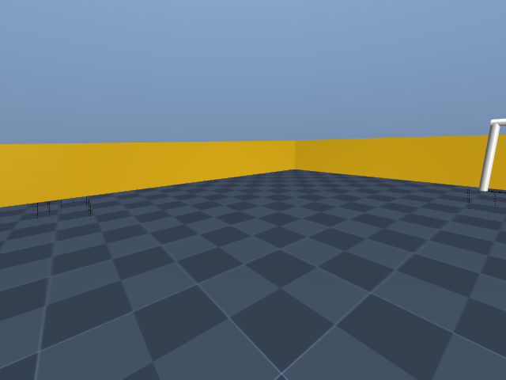
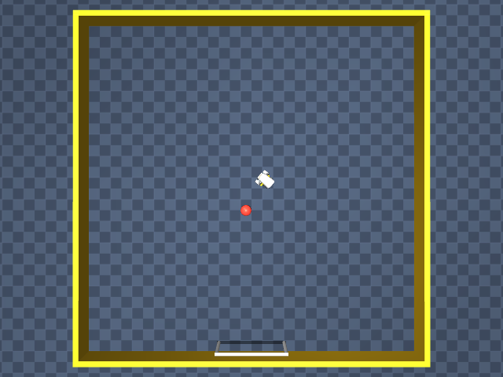

# Verification (2026-11-11)

| Run | Where | Result | File |
|---|---|---|---|
| Unit and behaviour suite (no ROS or MuJoCo) | box, Python 3.12 | 91 passed, 11 live tests skipped | `unit-pytest.txt` |
| `hermes plugins validate` on the copy installed with `hermes plugins install arcabotai/hermes-robots --enable` into a throwaway `HERMES_HOME` | box, Hermes `5581f2e` | passed (one warning about `scripts/e2e_hermes.py`, a dev script that imports Hermes internals to drive the dispatch path) | `hermes-plugins-validate.txt` |
| `hermes plugins doctor hermes-robots` | box | OK: 8 tools, 1 hook | `hermes-plugins-doctor.txt` |
| `scripts/e2e_hermes.py --ros`: mock, kinematic Microduck and a ROS 2 Humble turtlesim driven through `model_tools.handle_function_call` (real `pre_tool_call` hook) and `/robot` | box, Ubuntu 22.04 chroot with ROS 2 Humble, rosbridge, turtlesim and the synthetic camera | 36/36 checks passed | `e2e-hermes-dispatch-ros2-humble.txt` |
| Live tests against ROS 2 Humble turtlesim | box chroot | 6 passed (Microduck live tests skipped) | `live-ros2-humble-turtlesim-pytest.txt` |
| `scripts/blaxel_e2e.py`: the full suite plus every live test against ROS 2 **Jazzy** turtlesim and the **MuJoCo Microduck running Pollen's ONNX policies** (OSMesa rendering) | Blaxel sandbox (4 GB, deleted afterwards), 95 s | 102 passed (91 unit + 11 live) | `blaxel-ros2-jazzy-mujoco-pytest.txt` |

Camera frames grabbed through the plugin in the Blaxel run:

| Microduck head camera (MuJoCo) | Microduck overhead (MuJoCo) | turtlesim synthetic camera (ROS 2 Jazzy) |
|---|---|---|
|  |  |  |

Not covered yet: TurtleBot3 in Gazebo through this plugin. The ros backend is the hermes-ros code that drove a TurtleBot3
waffle in Gazebo Classic on Humble; that run used hermes-ros's own tool names. No physical robot has been driven.
